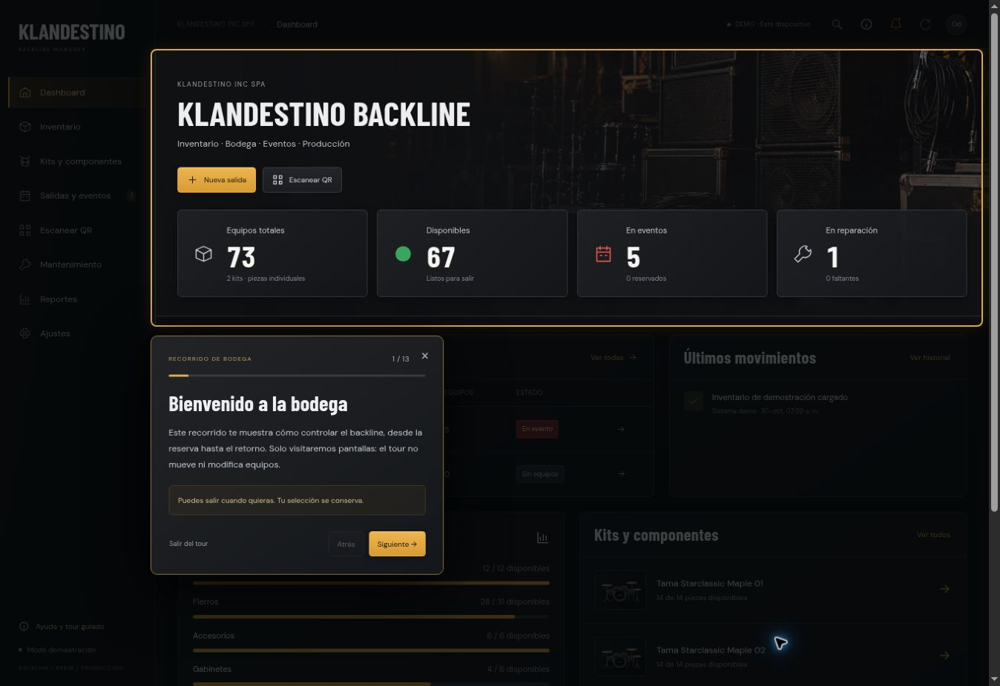

# Consola de bodega y tour guiado

Versión funcional publicada: `a201a2b823e3ee714551d246d19a6e12e0128884`.

- Interfaz negro/grafito y ámbar con fondo local optimizado, inventario compacto, filtros por estado/categoría, ficha de evento con pestañas y escáner adaptable.
- Tour contextual de 13 pasos, ofrecido en la primera visita y disponible desde Ayuda y Ajustes.
- Navegación anterior/siguiente, flechas del teclado, Escape, finalización y reapertura comprobadas en navegador.
- El recorrido completo conserva los 73 activos y el historial inicial de la demo: no llama comandos de inventario.
- La selección de inventario y la selección/categoría de un evento se restauran al abandonar el tour.
- Vista de teléfono validada con un viewport de 390 × 844 px en un iframe de QA local; no se utilizó un teléfono físico.
- Identificación manual de `MAR-1960A-002` verificada en la pantalla del escáner. No se solicitó acceso a una cámara física durante QA.
- 22 pruebas de dominio/persistencia PHP, 7 códigos QR codificados/decodificados y el flujo de la demo estática aprobados.
- Render confirmó el despliegue `live`; salud, CSS, imagen y bootstrap respondieron HTTP 200. El backend publicado es PHP en modo demo, con persistencia por navegador. La conexión SQL compartida sigue pendiente de configurar para el hosting final.

